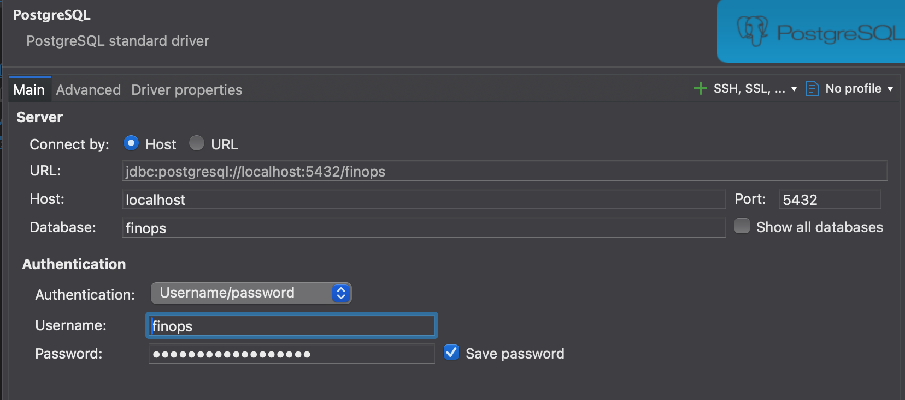
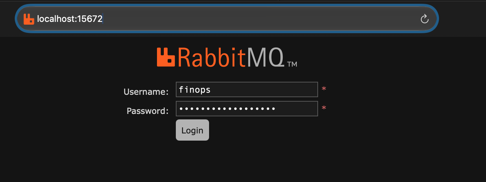
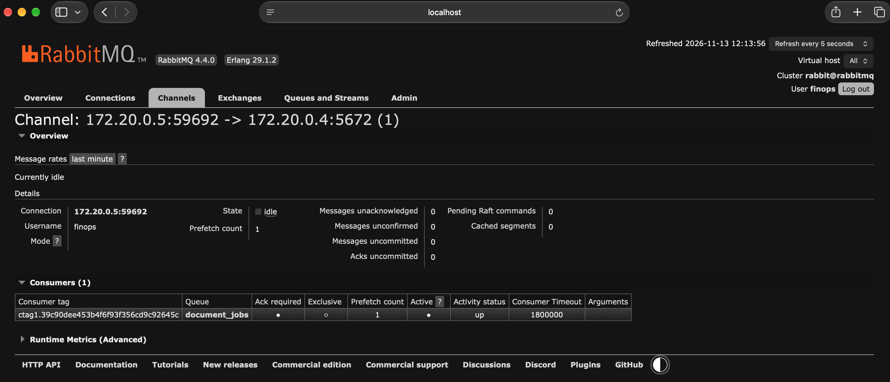

# Enterprise AI FinOps Gateway

A microservices gateway for enterprise AI workloads, built with .NET and Python and orchestrated with Docker Compose.

> **Status:** early development. The AI router only exposes a health check, and document processing is simulated.

## Run on a local dev box

### 1. Install Docker

Install [Docker Desktop](https://docs.docker.com/desktop/). It includes Docker Compose.

### 2. Configure and validate

```bash
cp .env.example .env     # local credentials used by Compose
docker compose config    # validates docker-compose.yml and resolves .env values
```

If `docker compose config` prints the merged configuration without errors, you're ready to go.

### 3. Build and start the stack

```bash
docker compose up --build -d   # build images and run in the background
docker compose ps              # every service should be "running" / "healthy"
docker compose logs -f worker-python   # optional: follow a service's logs
```

### 4. Inspect PostgreSQL

**From the terminal** with `psql` inside the container:

```bash
docker compose exec postgres \
  psql -U finops -d finops \
  -c "SELECT id, filename, status, created_at, completed_at FROM document_jobs ORDER BY created_at DESC;"
```

**From DBeaver** (or any SQL client), create a PostgreSQL connection with:

| Setting | Value |
|---|---|
| Host | `localhost` |
| Port | `5432` |
| Database | `POSTGRES_DB` from `.env` (default `finops`) |
| Username | `POSTGRES_USER` from `.env` (default `finops`) |
| Password | `POSTGRES_PASSWORD` from `.env` |



### 5. Inspect RabbitMQ

Open the management UI at <http://localhost:15672> and sign in with `RABBITMQ_USER` / `RABBITMQ_PASSWORD` from `.env`.



Under **Queues and Streams**, the `document_jobs` queue shows messages published by the gateway and consumed by the worker:



### 6. Stop the stack

```bash
docker compose down      # stop containers, keep data
docker compose down -v   # stop containers and delete the Postgres/RabbitMQ volumes
```


## Architecture

```
            ┌──────────────────┐   HTTP    ┌────────────────┐
client ───▶ │  gateway-dotnet  │ ────────▶ │ router-python  │
  :8081     │  ASP.NET Core 10 │           │    FastAPI     │
            └───┬─────────┬────┘           └────────────────┘
                │         │ publish
                │         ▼
                │   ┌──────────┐  consume  ┌────────────────┐
                │   │ RabbitMQ │ ────────▶ │ worker-python  │
                │   └──────────┘           └───────┬────────┘
                │                                  │
                ▼                                  ▼
            ┌──────────────────────────────────────────┐
            │              PostgreSQL 17               │
            └──────────────────────────────────────────┘
```

| Service | Stack | Role |
|---|---|---|
| `gateway-dotnet` | ASP.NET Core minimal API (.NET 10) | Public API entry point |
| `router-python` | FastAPI | AI smart router (internal only) |
| `worker-python` | Python, pika, psycopg | Consumes and processes document jobs |
| `postgres` | PostgreSQL 17 | Stores job state (`document_jobs` table) |
| `rabbitmq` | RabbitMQ 4 + management UI | Job queue (`document_jobs`) |

### Document job lifecycle

1. `POST /api/jobs` creates a job row with status `queued` and publishes a message to the durable `document_jobs` queue.
2. The worker picks up the message and marks the job `processing`. When it finishes it marks the job `completed` and only then acknowledges the message.
3. `GET /api/jobs/{id}` returns the job's current status.

Statuses: `queued` → `processing` → `completed` (`failed` is reserved).

## Getting started

### Prerequisites

- Docker with Docker Compose
- For local development outside Docker: [.NET 10 SDK](https://dotnet.microsoft.com/) and [uv](https://docs.astral.sh/uv/) (Python 3.13)

### Run the stack

```bash
cp .env.example .env    # then change the passwords
docker compose up --build
```

| Endpoint | URL |
|---|---|
| Gateway API | http://localhost:8081 |
| OpenAPI document (Development) | http://localhost:8081/openapi/v1.json |
| RabbitMQ management UI | http://localhost:15672 (credentials from `.env`) |
| PostgreSQL | `localhost:5432` |

All ports bind to `127.0.0.1` only.

### Try it

```bash
# Health checks
curl http://localhost:8081/health
curl http://localhost:8081/api/router/health

# Submit a document job
curl -X POST http://localhost:8081/api/jobs \
  -H 'Content-Type: application/json' \
  -d '{"filename": "invoice.pdf"}'

# Check its status (use the id from the previous response)
curl http://localhost:8081/api/jobs/<job-id>
```

## API

| Method | Path | Description |
|---|---|---|
| `GET` | `/health` | Gateway health |
| `GET` | `/api/router/health` | Router health via the gateway (`502` on router error, `504` if unreachable) |
| `POST` | `/api/jobs` | Create a document job. Body: `{"filename": "..."}` (1–255 chars). Returns `202 Accepted` |
| `GET` | `/api/jobs/{id}` | Get job status, or `404` if the job doesn't exist |

## Configuration

Docker Compose reads its settings from `.env`:

| Variable | Description |
|---|---|
| `POSTGRES_DB`, `POSTGRES_USER`, `POSTGRES_PASSWORD` | Database name and credentials |
| `RABBITMQ_USER`, `RABBITMQ_PASSWORD` | RabbitMQ credentials |

Compose turns these into service-specific settings: `ConnectionStrings__Postgres`, `RabbitMq__*` and `Router__BaseUrl` for the gateway, and `DATABASE_URL` and `RABBITMQ_*` for the worker.

## Local development

```bash
# Gateway
cd src/gateway-dotnet && dotnet run

# Router
cd src/router-python && uv run uvicorn app.main:app --app-dir src --reload

# Worker (requires DATABASE_URL, RABBITMQ_HOST, RABBITMQ_USER, RABBITMQ_PASSWORD)
cd src/worker-python && uv run python src/worker_python/worker.py
```

The Python Dockerfiles install from `requirements.txt`. After you change dependencies in `pyproject.toml`, regenerate it:

```bash
uv pip compile pyproject.toml -o requirements.txt
```

### Database schema

The schema is defined in [`infra/docker/postgres/init.sql`](infra/docker/postgres/init.sql). It runs only when the Postgres volume is first created, so to apply changes you must reset the volume:

```bash
docker compose down -v && docker compose up --build
```

## Project structure

```
.
├── docker-compose.yml
├── infra/docker/postgres/init.sql   # Database schema
└── src/
    ├── gateway-dotnet/              # ASP.NET Core API gateway
    ├── router-python/               # FastAPI AI router
    └── worker-python/               # RabbitMQ document worker
```

## Roadmap

- Real PDF extraction in the worker
- Bounded retries and a dead-letter queue for failed jobs, with the job marked `failed`
- AI routing logic in the router service
